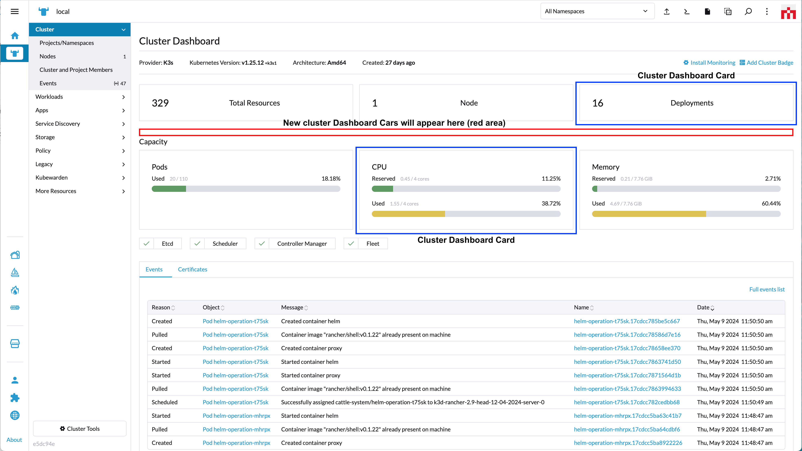
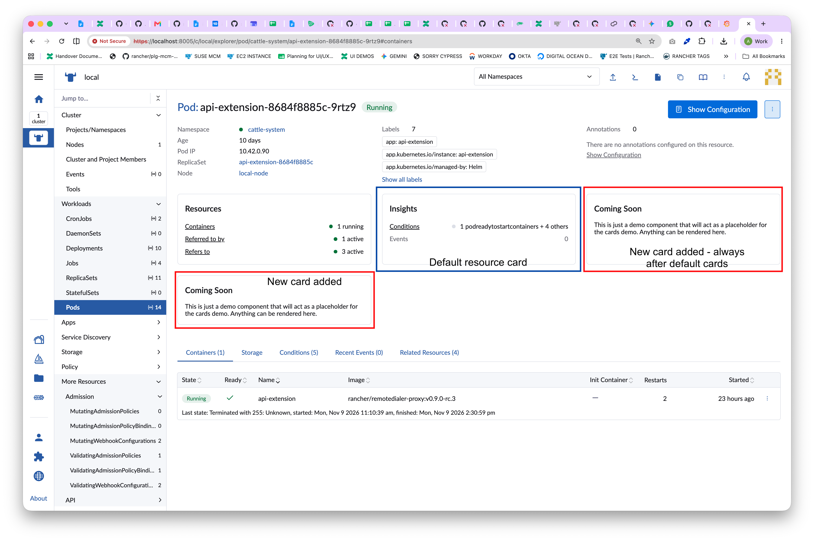

# Cards

Cards present information with a bordered box.

Cards are added to Rancher via the `addCard` method.

# addCard

*(Rancher version v2.7.2)*

This method adds a card element to the UI.

Method:

```ts
plugin.addCard(where: String, when: LocationConfig, options: Object);
```

_Arguments_

`where` string parameter admissable values for this method:

| Key | Type | Rancher Version | Description |
|---|---|---|---|
|`CardLocation.CLUSTER_DASHBOARD_CARD`| String | v2.7.2 | Location for a card on the Cluster Dashboard page |
|`CardLocation.RESOURCE_DETAIL_CARD`| String | v2.17.0 | Location for a card in the row of cards on a resource detail page |

<br/>

`when` Object admissable values:

`LocationConfig` as described above for the [LocationConfig object](./common#locationconfig).

<br/>
<br/>

## CardLocation.CLUSTER_DASHBOARD_CARD options

*(From Rancher version v2.7.2)*



`options` config object. Admissable parameters for the `options` with `'CardLocation.CLUSTER_DASHBOARD_CARD'` are:

| Key | Type | Description |
|---|---|---|
|`label`| String | Card title |
|`labelKey`| String | Same as "label" but allows for translation. Will superseed "label" |
|`component`| Function | Component to be rendered aas content of a "Cluster Dashboard Card" |

Usage example for `'CardLocation.CLUSTER_DASHBOARD_CARD'`:

```ts
plugin.addCard(
  CardLocation.CLUSTER_DASHBOARD_CARD,
  { cluster: ['local'] },
  {
    label:     'some-label',
    labelKey:  'generic.comingSoon',
    component: () => import('./MastheadDetailsComponent.vue')
  }
);
```

<br/>
<br/>

## CardLocation.RESOURCE_DETAIL_CARD options

*(From Rancher version v2.17.0)*



Resource detail pages show a row of cards under the masthead, which Rancher fills with cards such as `Resources` and `Insights`. An extension can add its own cards to that row for any resource type, including resource types that have no cards of their own.

`options` config object. Admissable parameters for the `options` with `'CardLocation.RESOURCE_DETAIL_CARD'` are:

| Key | Type | Description |
|---|---|---|
|`label`| String | Card title |
|`labelKey`| String | Same as "label" but allows for translation. Will superseed "label" |
|`component`| Function | Component to be rendered as the content of the card |
|`weight`| Number | Optional. Order of the card amongst the other extension cards, highest first. Cards with the same weight keep the order they were added in. Extension cards always come after the cards Rancher adds itself |

Rancher renders the card itself - the border and the title come from the same component the built-in cards use, and your component is rendered as the body of the card. The component is given the resource being viewed as a `resource` prop.

Usage example for `'CardLocation.RESOURCE_DETAIL_CARD'`:

```ts
plugin.addCard(
  CardLocation.RESOURCE_DETAIL_CARD,
  { resource: ['pod'] },
  {
    label:     'some-label',
    labelKey:  'generic.comingSoon',
    component: () => import('./PodDetailCard.vue'),
    weight:    10
  }
);
```

And the component itself, `PodDetailCard.vue`:

```vue
<script setup lang="ts">
defineProps<{ resource: any }>();
</script>

<template>
  <div>
    {{ resource.metadata.name }} is running {{ resource.spec.containers.length }} container(s)
  </div>
</template>
```